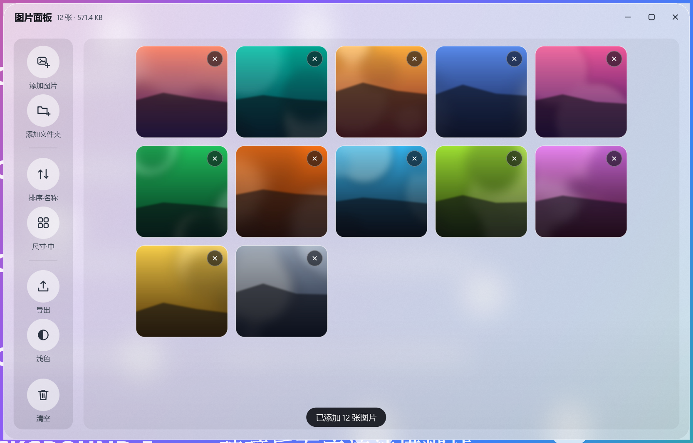

# 图片面板 · 毛玻璃桌面工具

左侧是一列功能键，右侧是图片文件输入口。窗口可以任意放大缩小，每张照片都带删除键，
整窗是真正的毛玻璃（实时模糊窗口背后的桌面内容），视觉参考 iOS 控制中心的那套材质。



## 运行

```
python app.py
```

或者双击 `启动图片面板.bat`（用 `pythonw` 启动，不留控制台窗口）。

依赖：Python 3.10+ 和 `PySide6`（开发环境为 Python 3.12.10 + PySide6 6.12.0）。不需要联网。

## 界面

**左侧功能键**（从上到下）

| 键 | 作用 |
| --- | --- |
| 添加图片 | 打开文件选择器，可多选 |
| 添加文件夹 | 整目录导入，自动过滤非图片 |
| 排序·名称 / 排序·时间 | 切换排序方式，图标和文字同时变化 |
| 尺寸·小 / 中 / 大 | 切换缩略图尺寸（104 / 148 / 196 px） |
| 导出 | 把当前列表里所有图片复制到指定文件夹，重名自动加序号 |
| 浅色 / 深色 | 切换主题，材质着色、文字、控件一起变 |
| 清空 | 危险操作，红色悬停 + 二次确认 |

**右侧图片区**

- 空的时候是一个拖放区：把图片拖进来，或点「选择图片…」
- 有图之后是一格格卡片，**每张右上角都有删除键**（常驻显示，悬停变红）
- 单击选中（选中态是强调色描边 + 左上角对勾），`Delete` 批量删除选中项
- 双击交给系统默认看图程序打开
- 图片多的时候在区域里滚轮滚动，右侧出现细滚动条

**窗口**

- 无边框，按住标题栏拖动
- 四边 + 四个角都能拖拽缩放，也可点右上角最大化（双击标题栏同样可以）
- 最小 760 × 480；窗口变矮时左侧功能键自动收成纯图标，不会互相压字
- 关闭时记住窗口位置和大小

## 快捷键

| 快捷键 | 作用 |
| --- | --- |
| `Ctrl+O` | 添加图片 |
| `Ctrl+A` | 全选 |
| `Esc` | 取消选择 |
| `Delete` / `Backspace` | 删除选中的（焦点在某张卡片上时删这一张） |
| `Space` | 选中 / 取消选中的那张 |
| `Enter` | 打开焦点所在的图片 |

## 毛玻璃是怎么做出来的

在 Windows 上「毛玻璃」有几条路，实测（Windows 11 25H2 + Qt 6.12）只有一条真的管用：

| 方案 | 结果 |
| --- | --- |
| `DwmSetWindowAttribute(DWMWA_SYSTEMBACKDROP_TYPE)` | Qt 的分层窗口上退化成一块不透明的浅色填充，看不见背后的桌面 |
| `SetWindowCompositionAttribute(ACCENT_ENABLE_BLURBEHIND)` | 能透，但只有灰糊，没有材质感 |
| **`SetWindowCompositionAttribute(ACCENT_ENABLE_ACRYLICBLURBEHIND)`** | **真正的亚克力：实时模糊窗口背后的窗口 / 桌面** |

所以 `glasspanel/effect.py` 的顺序是「亚克力 → 模糊 → 纯色降级」，非 Windows 或 API 失败时自动退回画一层半透明浅玻璃，界面不会崩。

两个细节：

- 亚克力模糊作用于**整块窗口矩形**，圆角必须用 `SetWindowRgn` 裁（`CreateRoundRectRgn`），否则四个角会露出方形的模糊块。最大化时取消裁剪、还原时恢复。
- 拖动 / 缩放窗口时亚克力跟随会有拖影，所以交互期间临时降级成纯色，松手 120ms 后再切回亚克力（`GlassMaterial.suspend() / resume()`）。

浅色主题的着色不透明度是 `0xB8`（72%），刻意低于常见的 90% 左右 —— 再高就看不见背后的东西了，就不叫毛玻璃了。

## 对齐 Apple 设计规范的点

来自 `emilkowalski/skills` 的 **apple-design** 技能（WWDC 设计原则）。

- **响应**：按键在**按下瞬间**就缩放（`PRESS_SCALE`），不是等抬起；弹簧从「当前值」出发，连续点击可以随时打断、反向。
- **弹簧**：默认临界阻尼（`damping 1.0`）不过冲；只有带速度的场景（拖入高亮）才用轻微回弹（`damping 0.8`）。
- **材质分层**：侧栏是「更重的材质」（压一层深色），内容区是极轻的凹陷托盘，卡片是图片本身 —— 层级靠材质重量区分，不靠分割线。顶边留一道受光，让玻璃有厚度。
- **不叠浅色**：卡片是图片（不透明），控件底色只叠在材质上，没有出现「浅色叠浅色」导致文字糊掉的情况。
- **字体**：字号 + 字重 + 字距作为一组定义（`theme.TYPE`）；大字号收紧字距（`display -0.6`），小字号略微放开（`caption +1.0`）；行高与字号反向（大标题 1.20，正文 1.50）；最小字号 11px，用系统字体。
- **对比度**：按最坏情况（纯黑桌面透过来）算，主文字、次要文字、强调色上的白字全部 ≥ 4.5:1（自测里逐条断言）。
- **间距与圆角**：全部落在 4pt 网格上；圆角是统一阶梯（窗口 22 > 卡片 14 > 控件 10）。
- **无障碍**：读 Windows 的「动画效果」开关（`SPI_GETCLIENTAREAANIMATION`），关掉时用瞬时状态而不是长动画；所有按键可 Tab 聚焦并有焦点环；删除是危险操作，先确认再执行。

## 自测

```
python work/glass/verify.py     # 53 项行为断言
```

覆盖：材质与圆角裁剪、八向缩放与最小尺寸、格式白名单与去重、每张卡片的删除键命中、
键盘删除与批量删除、排序与缩略图尺寸、主题切换、对比度、字体与间距规范、导出落盘、空状态。

## 已知差距

- 只有浅色 / 深色两套固定主题，没有跟随系统自动切换。
- 导入是同步的：一次拖进几百张会卡一下（还没做后台缩略图线程）。
- 滚轮滚到两端是硬边界，没有做橡皮筋回弹。
- 没有图片预览大图，双击是交给系统看图程序。